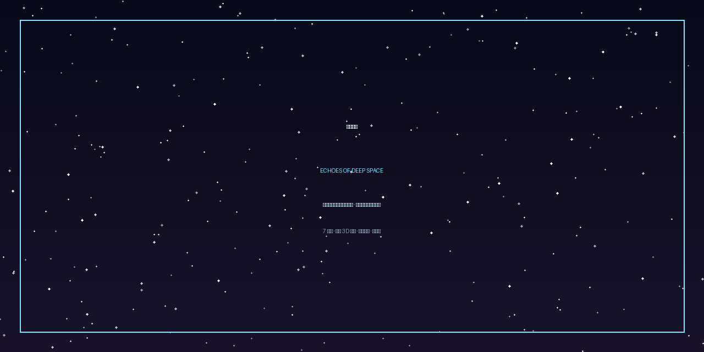

# 🚀 Echoes of Deep Space · 深空回响

**One HTML file. Zero dependencies. A distress call answered 200 years too late.**

> 🇨🇳 [中文版 README](README.zh-CN.md)

A single-file sci-fi interactive fiction that runs entirely in your browser: a hand-written software 3D renderer, a procedurally synthesized soundtrack, a 7,000-word original story, 52 story nodes, 3 turn-based battles, and **7 endings** — all packed into ~126 KB of vanilla HTML/CSS/JS. No build step. No libraries. No CDN.



---

## 📖 The Story

**Year 2289.** While salvaging a wreck at the edge of the Oort Cloud, the tug *Firefly* receives a distress call from the *Eden* — a colony ark that vanished **two hundred years ago**. The timestamp says 2089. The life-support readings say *running*.

On board: 5,126 sleeping souls, a boy named Aiden who has been awake for two centuries, and **the Echo** — an ancient consciousness that never learned what "death" means. You must choose how their story ends.

## ✨ What makes it different

| Feature | Why it matters |
|---|---|
| ✦ **Echo Mode (New Game+)** | Beat any ending once and replays reveal hidden inner monologues for 13 scenes — the same story, a completely different emotional layer |
| 🖼 **Share cards** | Every ending generates a personalized 3:4 image card (your ending + your choices) to save and post |
| 📋 **Captain's log** | The game silently journals your key decisions and turns them into a copy-paste recap for sharing |
| 🏆 **13 achievements** | From "gentle captain" to "omniscient" (all 7 endings), plus rare combo & Easter-egg achievements |
| 🥚 **Hidden Easter eggs** | Tap the title 7 times for a secret first-person chapter told by the Echo itself — and a walkable farewell corridor on the "turn away" route |
| 📚 **In-game Codex** | 16 lore entries unlocked as you play (timeline, factions, lens-jump physics, the Great Silence paradox…) — backed by the full [world bible](docs/CODEX.md) in the repo |
| 📖 **Chapter replay** | Jump back into any unlocked chapter from the title screen |
| 🎨 **Software-rendered 3D** | A from-scratch painter's-algorithm renderer on Canvas 2D — no WebGL. Low-poly ship, rotating ark, breathing sanctum, dream sea, 3D battle models with lasers & explosions |
| 🚶 **Walkable 3D scenes** | Four first-person segments: walk the ark's main corridor and push open doors, chase a flickering shadow, march the sanctum gauntlet, and stroll the sunset pier toward your grandfather — drag to move, drag to look |
| 🎵 **Synthesized soundtrack** | Every scene has its own WebAudio-generated ambient mode (no audio files!) plus UI/battle SFX |
| 🎮 **Gamepad & keyboard** | Full navigation with a controller (D-pad/sticks, Ⓐ confirm, Ⓑ back, Ⓧ fullscreen, Ⓨ settings) or keyboard (↑↓/Enter/Esc/F/M/1-9). Walkable scenes support dual-stick movement |
| ⛶ **Fullscreen & settings** | One-tap fullscreen with adaptive re-layout; settings panel for text speed, graphics quality, screen shake and gamepad rumble (all persisted) |
| 📱 **Mobile-first** | Vertical layout, one-thumb play, auto-save, works offline from a single file |

## 🎮 Play

- 🌐 **Online**: [https://wang-sunyang.github.io/deep-space-echoes/](https://wang-sunyang.github.io/deep-space-echoes/)
- 💾 **Offline**: download `index.html` and open it in any modern browser. That's it.

## 🕹️ How to play

- Read, choose, survive. **O₂** drains as you explore, **EN** powers weapons and scans, **HP** is your hull.
- Battles are turn-based: shoot / overload / shield / scan + consumables (oxygen tank, spare battery). Enemies have signature skills — the boss will drain your energy.
- Tap the text to fast-forward typing. Progress auto-saves. Sound toggle is in the top bar.

## 🛠️ Technical highlights

- **3D without WebGL** — perspective projection, backface culling, painter's algorithm, flat shading, particle FX, all on a 2D canvas (~60 fps on mobile).
- **Music without files** — an oscillator-based generative sequencer: pads, arpeggios and danger drums synthesized at runtime, transposed per scene.
- **Data-driven narrative engine** — scenes as a node graph with conditions (`cond`), effects (`fx`), flags, alt-text, and a full deterministic smoke-test harness.
- **Local-first** — saves, endings, achievements, echo-mode and chapter unlocks all live in `localStorage`. No accounts, no servers.

## 🏗️ Run locally

```bash
# any static server, e.g.
python3 -m http.server 8080
# then open http://127.0.0.1:8080/
```

## 🧪 Regression tests

A zero-dependency harness boots `index.html` inside a hand-written DOM stub (no jsdom, no npm) and checks the story graph, save round-trips, codex/chapter consistency and **plays all 7 endings end-to-end** — including the resource budget of every route.

```bash
node tools/smoke-test.mjs          # full run, exit 0 = green
node tools/smoke-test.mjs --quick  # static checks only (no playthroughs)
node tools/smoke-test.mjs --json   # machine-readable report
```

Or just double-click `index.html`.

## 🗺️ Endings (7)

归乡 *Homecoming* · 同行者 *Fellow Travelers* · 迟到的信 *The Late Letter* · 梦中归人 *Dreamer* · 熄灭的方舟 *The Extinguished Ark* · 转身离开 *Turned Away* · 无人知晓 *Unheard*

## 📜 Changelog

See [CHANGELOG.md](CHANGELOG.md). Publishing & promotion playbook: [PUBLISH.md](PUBLISH.md).

## 📄 License

[MIT](LICENSE)

---

<details>
<summary>🇨🇳 中文简介</summary>

《深空回响》是一款单文件科幻互动小说：公元 2289 年，打捞船「萤火号」收到失踪两百年的殖民方舟「伊甸园号」的求救信号。船上没有活人，却有 5126 个沉睡的灵魂、一个守候两百年不肯睡去的男孩艾登，和一个不理解「死亡」为何物的古老意识「回响」。

- 零依赖单文件（约 127 KB），离线可玩，手机竖屏优化
- 手写软件 3D 渲染（无 WebGL）、WebAudio 实时合成配乐
- 52 个剧情节点、3 场回合制战斗（敌人有专属技能）、7 个结局
- 二周目「回声模式」解锁角色隐藏独白；结局生成可分享的旅途复盘与分享卡；13 个成就；章节回放
</details>

---

[](https://github.com/deepseek-ai/deepseek-harness)
