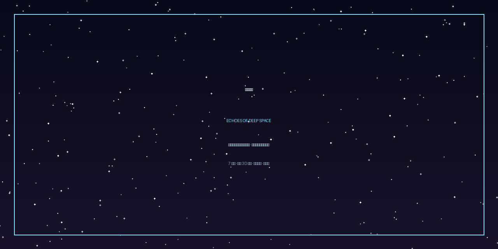

# 🚀 深空回响 · Echoes of Deep Space

**一个 HTML 文件。零依赖。一封迟到两百年的求救信。**

单文件科幻互动小说，浏览器打开即玩：手写软渲染 3D、实时合成配乐、约 8600 字原创剧情、60 个剧情节点、4 场回合制战斗、**9 个结局**——全部打包在约 144 KB 的纯 HTML/CSS/JS 里。无构建、无库、无 CDN。



---

## 📖 剧情

**公元 2289 年。** 打捞船「萤火号」在奥尔特云边缘回收残骸时，收到一封求救信——来自两百年前失踪的殖民方舟「伊甸园号」。时间戳写着 2089 年，生命维持系统读数写着：运行中。

船上没有活人。却有 5126 个沉睡的灵魂、一个守候两百年不肯睡去的男孩艾登，和一个从未学会「死亡」为何物的古老意识——**回响**。

他们的故事如何收场，由你决定。

## ✨ 特色

| 特性 | 说明 |
|---|---|
| ✦ **回声模式（二周目）** | 通关任意结局后，重玩会在 14 个场景解锁角色隐藏内心独白——同样的故事，完全不同的情感层次 |
| 🚶 **可操作 3D 场景** | 5 个第一人称步行小节：推开主廊道的舱门、追逐闪烁的人影、走过圣坛列队之门、黄昏码头走向外公、黑夜里走向最后的门 |
| 🎨 **手写软渲染 3D** | 从零实现的画家算法渲染器（Canvas 2D，无 WebGL）：低多边形飞船、自转的方舟、呼吸的圣坛、梦境之海、带激光与爆炸的 3D 战斗 |
| 🎵 **实时合成配乐** | 每个场景都有 WebAudio 生成的氛围音乐（无音频文件），另有 UI 与战斗音效 |
| 📚 **世界观档案库** | 16 条设定随剧情解锁（时间线、四大势力、透镜跃迁三铁律、大寂静悖论……），仓库内附完整[世界观设定集](docs/CODEX.md) |
| 🖼 **分享卡** | 每个结局生成一张个性化 3:4 卡片（你的结局 + 你的抉择），长按保存分享 |
| 📋 **船长日志** | 自动记录关键抉择，一键复制"我的旅途"文案 |
| 🏆 **16 个成就** | 从「温柔船长」到集齐 9 结局的「全知」，还有组合成就与彩蛋成就 |
| 🥚 **隐藏彩蛋** | 标题连点 7 次，听见回响的低语（隐藏章节）；「转身离开」路线有一段可步行的告别走廊 |
| 📖 **章节回放** | 标题页直接重玩已解锁的任意章节 |
| 🎮 **手柄 / 键盘适配** | 手柄完整导航（十字键/摇杆选择、Ⓐ 确认、Ⓑ 返回、Ⓧ 全屏、Ⓨ 设置）；键盘可用 ↑↓ 选择、Enter 确认、Esc 返回、F 全屏、M 静音、数字键直接选；步行场景支持双摇杆移动与环视 |
| ⛶ **全屏与设置** | 一键全屏并自适应重排；设置面板可调文字速度、画面品质、屏幕震动、手柄震动，全部本地持久化 |
| 📱 **手机优先** | 竖屏布局、单指操作、自动存档、离线可玩 |

## 🎮 立即试玩

- 🌐 **在线**：https://wang-sunyang.github.io/deep-space-echoes/
- 💾 **离线**：下载 `index.html`，任何现代浏览器打开即可。

## 🕹️ 玩法

- 阅读、抉择、活下去。**O₂**（氧气）随探索消耗，**EN**（能量）驱动武器与扫描，**HP**（船体）是你的生命。
- 战斗为回合制：射击 / 过载 / 护盾 / 扫描 + 道具（氧气罐、备用电池）。敌人有专属技能——Boss 会抽干你的能量。
- 步行场景：左半屏拖动移动，右半屏拖动环视。
- 点击正文加速打字。进度自动保存。顶栏可开关声音。

## 🛠️ 技术亮点

- **无 WebGL 的 3D**：透视投影 + 背面剔除 + 画家算法 + 平面着色 + 粒子特效，全部跑在 2D 画布上，手机 60 帧。
- **无音频文件的音乐**：基于振荡器的生成式音序器，随场景移调，实时合成。
- **数据驱动的叙事引擎**：节点图 + 条件（cond）+ 效果（fx）+ 旗标 + 分支文本，配全套确定性冒烟测试。
- **纯本地**：存档、结局、成就、回声模式、档案库全部存在 localStorage。无账号、无服务器。

## 🗺️ 七个结局

归乡 · 同行者 · 迟到的信 · 梦中归人 · 熄灭的方舟 · 转身离开 · 无人知晓

## 🌌 世界观

本作拥有完整的设定体系：**透镜跃迁三铁律**解释信号为何迟到两百年，**意识科学**解释圣坛与乐园，**大寂静悖论**回答费米悖论——"文明不是灭绝了，是离开了"。
完整设定集见 [docs/CODEX.md](docs/CODEX.md)，含 7 个续作钩子。

## 🏗️ 本地运行

```bash
python3 -m http.server 8080
# 打开 http://127.0.0.1:8080/
```

或直接双击 `index.html`。

## 📜 版本历史

见 [CHANGELOG.md](CHANGELOG.md)。发布与推广手册：[PUBLISH.md](PUBLISH.md)。

## 📄 许可

[MIT](LICENSE)

---

[English README](README.md) · 本作剧情与代码由 DeepSeek 协助创作

[](https://github.com/deepseek-ai/deepseek-harness)
